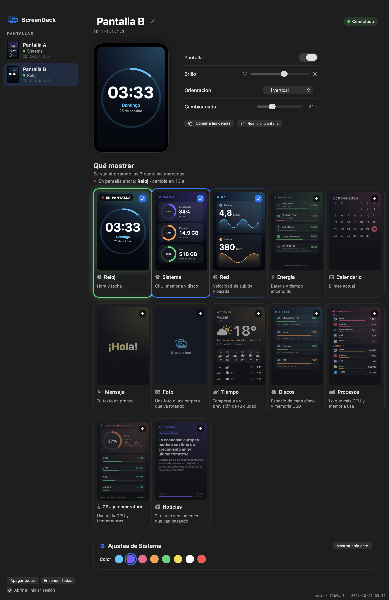
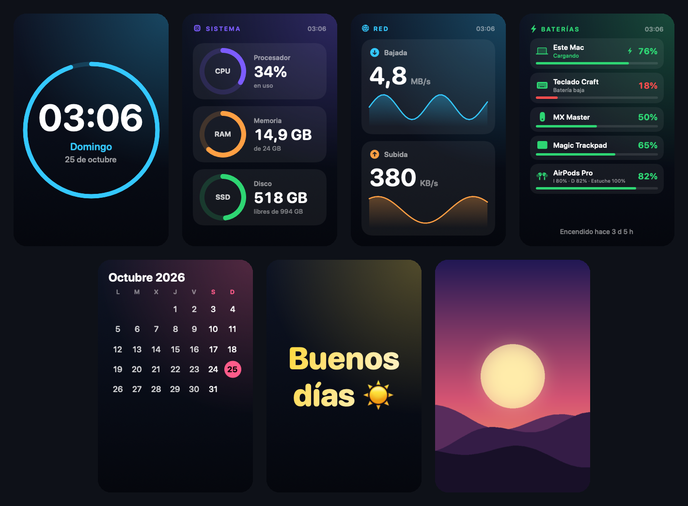
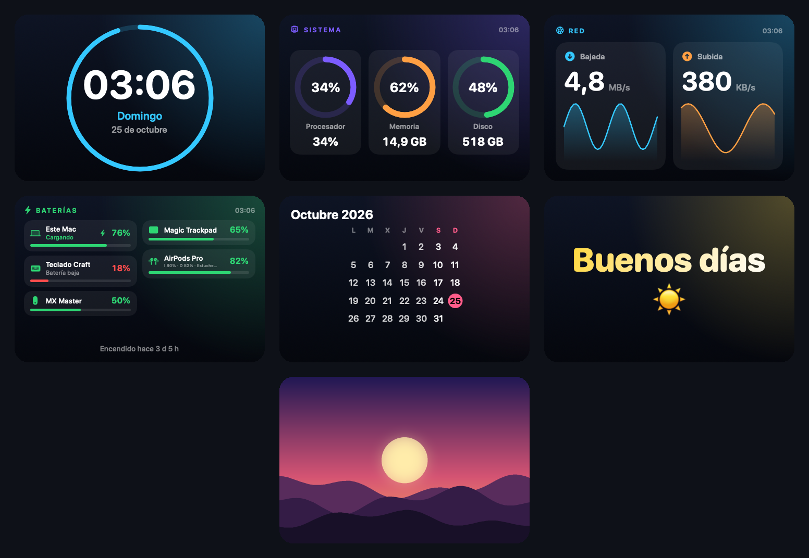
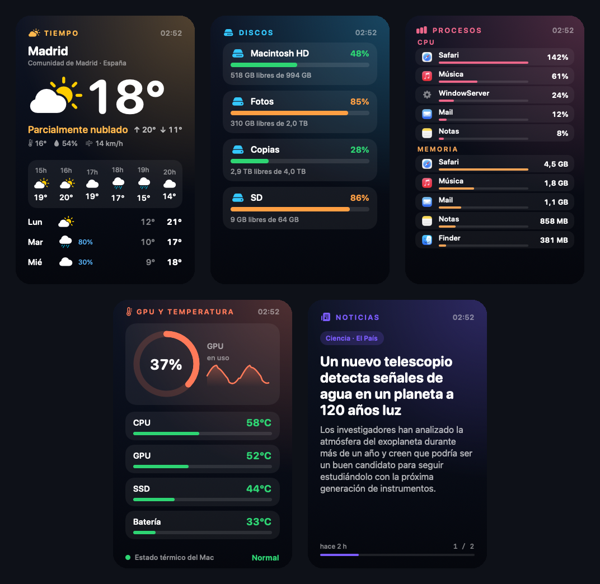
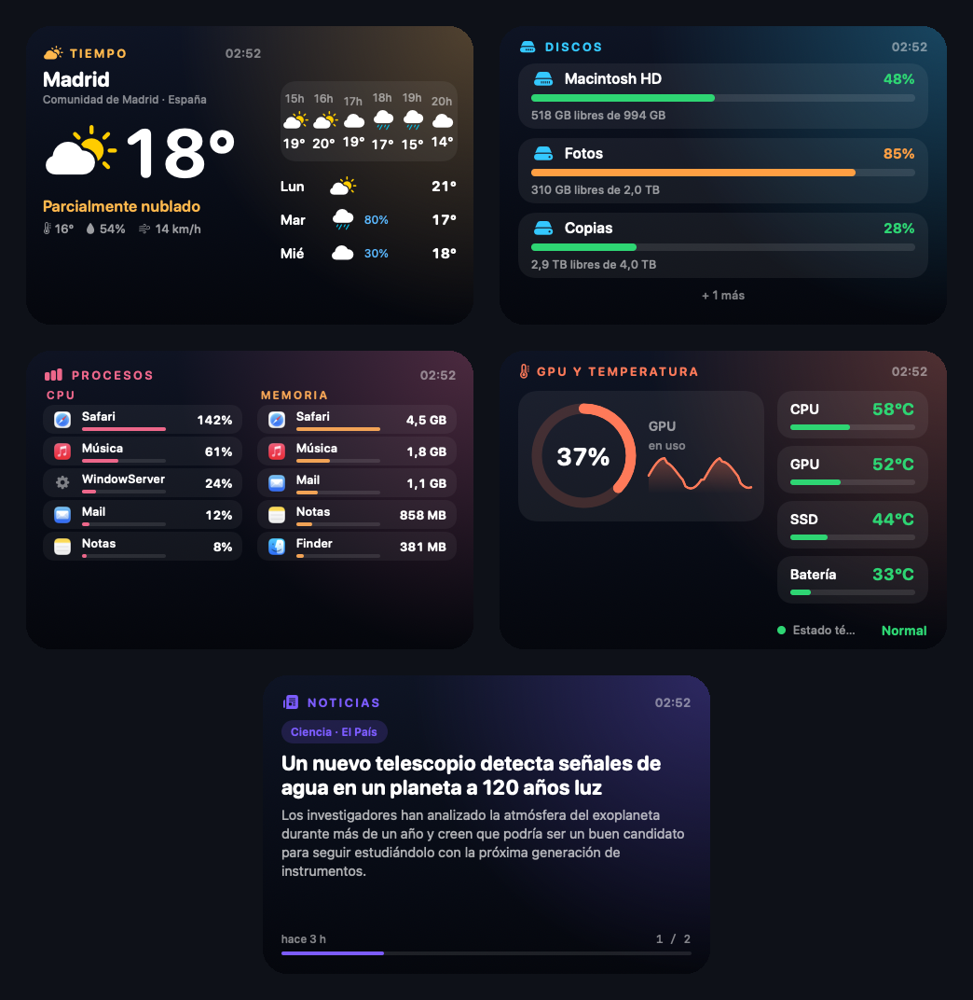
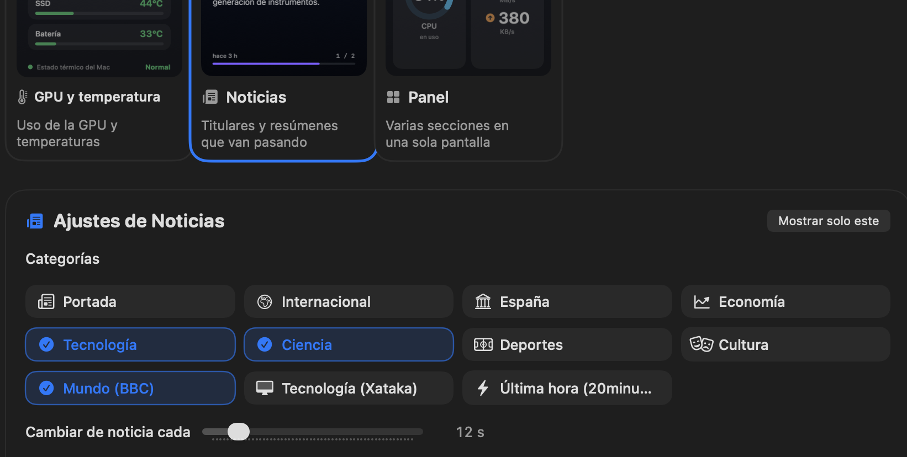
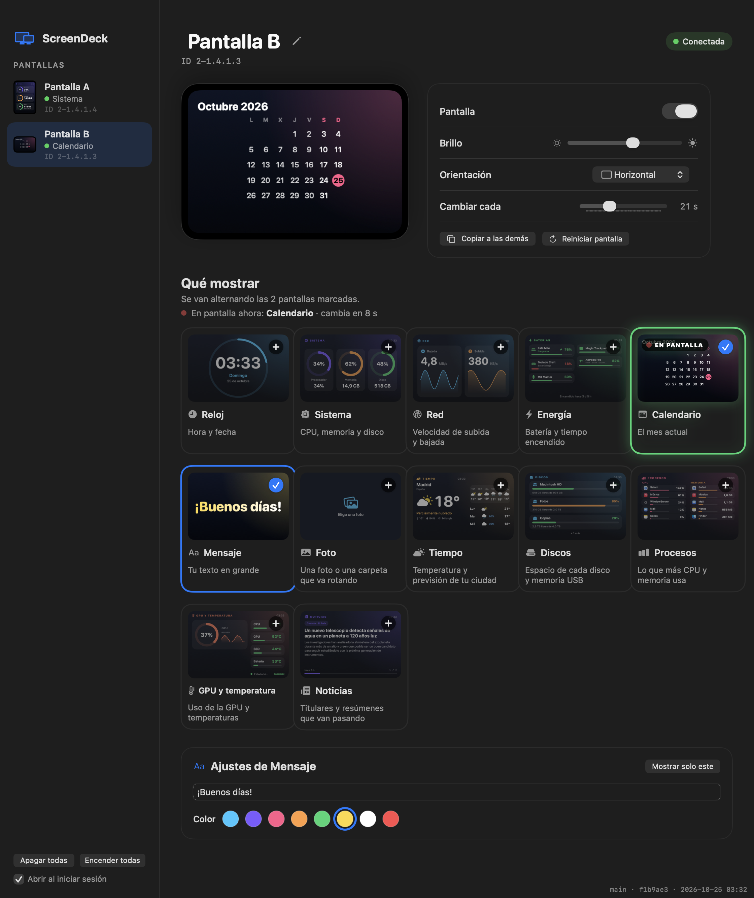
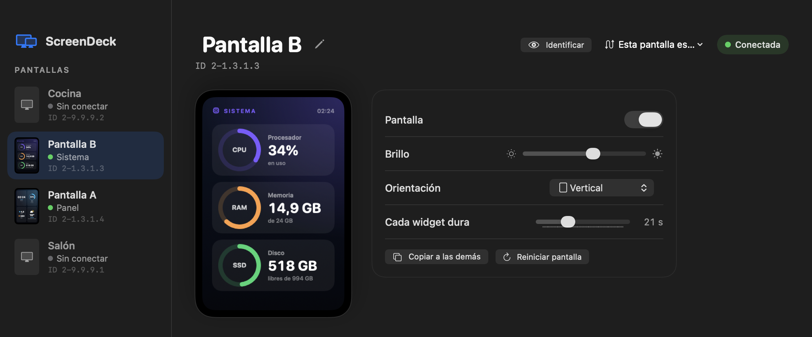

# ScreenDeck

App nativa para macOS que controla las pantallas USB **Turing Smart Screen de 3,5"** (y sus clones `UsbMonitor` / TURZX). Detecta **todas las que enchufes**, las muestra en una barra lateral y a cada una le envías los widgets que quieras: reloj, estado del sistema, red, energía, calendario, un mensaje o una foto.



  

## Qué hace

- **Detecta las pantallas solas.** Una, dos o las que tengas: aparecen y desaparecen de la barra lateral al enchufarlas y desenchufarlas. No hay que configurar puertos.
- **Vista previa en vivo** de lo que muestra cada pantalla, dentro de la propia app. En «Qué mostrar», la tarjeta del widget que la pantalla está pintando en ese momento lleva la etiqueta **EN PANTALLA** y muestra el fotograma exacto que se envía; si hay varios en rotación, se va moviendo de una a otra en directo, con una línea que dice cuánto falta para el siguiente.
- **Doce widgets** que se adaptan a vertical y horizontal. Marca uno y queda fijo; marca varios y se alternan cada N segundos.
- **Ajustes por pantalla:** nombre (haz clic en él para cambiarlo), encendida/apagada, brillo, 4 orientaciones y color de cada widget. Se guardan aunque desconectes la pantalla y se recuerdan por **puerto USB**; el ID de cada una (por ejemplo `ID 2-1.4.1.3`) se ve junto a su nombre.
- **Orden a tu gusto:** arrastra las pantallas en la barra lateral para ordenarlas (o clic derecho → «Mover arriba» / «Mover abajo»). El orden se guarda, y una pantalla desconectada **conserva su sitio**: no salta al final ni queda siempre detrás de las conectadas.
- **Pantallas guardadas:** las que no están conectadas se quedan en la misma lista, atenuadas y con «Sin conectar». Si has movido una pantalla a otro puerto, le trasladas su configuración con un clic (la pantalla de destino ocupa su sitio), o la olvidas.
- **Icono en la barra de menús** para encender o apagar cada pantalla sin abrir la ventana. Cerrar la ventana no detiene las pantallas.
- **Pase de fotos:** el widget Foto puede mostrar una imagen o **rotar una carpeta entera** cada N segundos, en orden o aleatorio.
- **Sin cuentas ni claves.** Solo se conecta a internet si usas **Tiempo** (Open-Meteo, con las coordenadas de la ciudad que elijas) o **Noticias** (los feeds RSS públicos de cada medio); sin ellos no hace ninguna conexión. macOS solo pregunta por permisos si eliges una carpeta protegida (Escritorio, Documentos o Descargas) para el pase de fotos. No usa servicios, ni Python, ni navegador.
- **Fluida:** solo reenvía las filas de la imagen que cambian, no el fotograma entero cada vez.

## Pantallas compatibles

ScreenDeck habla con la **Turing Smart Screen 3,5" (Rev. A)** y sus clones (UsbPCMonitor 3,5", TURZX 3,5" IPS…). En macOS aparecen así:

| Dato | Valor |
|---|---|
| Producto USB | `UsbMonitor` |
| VID : PID | `1a86 : 5722` |
| Número de serie | `USB35INCHIPSV2` |
| Resolución | 320 × 480 (vertical) |
| Pantalla de arranque de fábrica | `PLEASE RUN THE APP · www.turzx.com` |

Para comprobar la tuya:

```bash
ioreg -p IOUSB -l | grep -A8 UsbMonitor
```

Otras revisiones de Turing (B, C, D) y otros tamaños usan otro protocolo y **no están soportados**.

## Pase de fotos

El widget **Foto** tiene dos modos: una sola imagen, o una **carpeta** que se recorre sola.

- Formatos: JPG, PNG, HEIC, GIF, TIFF, BMP y WebP. Ignora archivos ocultos y lo que no sea imagen; si alguna está dañada, la salta.
- Se recorren por **orden de nombre** (`foto2` antes que `foto10`) o en **orden aleatorio**, con una mezcla distinta en cada vuelta.
- El intervalo va de 3 a 120 segundos. Las imágenes que añadas a la carpeta aparecen solas en unos 30 segundos.
- Con varias pantallas apuntando a la misma carpeta y el mismo intervalo, **van a la par**.
- Por defecto la foto **rellena la pantalla** recortando los bordes; puedes pedir que se vea entera, con barras negras.
- Las fotos se reducen al abrirlas (a 960 px, de sobra para la pantalla), así que una carpeta de fotos de 12 megapíxeles no pesa ni va lenta.
- Respeta la orientación de las fotos hechas con el móvil.

## Los widgets

Cada widget es una vista de SwiftUI de 320 × 480 (o 480 × 320 en horizontal), así que lo que ves en la app es exactamente lo que sale en la pantalla.



| Widget | Qué muestra | Ajustes |
|---|---|---|
| **Reloj** | Hora, día de la semana y fecha, con un anillo de segundos | Color |
| **Sistema** | CPU, memoria y espacio libre de disco | Color |
| **Red** | Velocidad de bajada y subida, con gráfica | Color |
| **Energía** | La batería del Mac **y la de todos los accesorios que macOS ve** (trackpad, ratón, teclado, auriculares, AirPods…), cada una con su icono, porcentaje y color según la carga. Si solo hay una, vista grande; sin ninguna, «conectado a la corriente». Siempre con el tiempo encendido | Color |
| **Calendario** | El mes actual con el día de hoy marcado (semana desde el lunes) | Color |
| **Mensaje** | Un texto tuyo en grande | Texto y color |
| **Foto** | Una imagen a pantalla completa, o **una carpeta de imágenes que va rotando** | Foto o carpeta, intervalo (3–120 s), orden aleatorio, rellenar o ajustar |

En horizontal se reorganizan, no se estiran:



### Widgets de datos: tiempo, discos, procesos, GPU y noticias





| Widget | Qué muestra | Ajustes |
|---|---|---|
| **Tiempo** | Temperatura, sensación, humedad y viento; las próximas 6 horas y 3 días con probabilidad de lluvia | Ciudad (buscador, sin permiso de ubicación) y color |
| **Discos** | Cada volumen local con barra de uso y espacio libre; los USB y discos externos aparecen y desaparecen en unos 20 segundos | Color |
| **Procesos** | Las 5 apps que más **CPU** y las 5 que más **memoria** usan, con su icono. Los procesos auxiliares se suman a su app (Chrome y sus «Helper» cuentan como uno) | Color |
| **GPU y temperatura** | Uso de la GPU con gráfica, temperaturas (CPU, GPU, SSD, batería, las que dé tu Mac) y estado térmico de macOS | Color |
| **Noticias** | Titular y resumen de la noticia, con la categoría y la fuente, cuánto hace de ella y una barra hasta la siguiente | Categorías, intervalo, fuente RSS propia y color |

#### Tiempo

Busca tu ciudad en los ajustes del widget y elígela de la lista. Los datos vienen de [Open-Meteo](https://open-meteo.com) (sin clave ni cuenta) y se renuevan cada 10 minutos. La app solo envía a Open-Meteo las coordenadas de la ciudad que has elegido; no pide tu ubicación.

#### Noticias



Elige una o varias categorías y las noticias se **mezclan por turnos** entre ellas, cambiando cada N segundos (de 5 a 60). Se descargan de los feeds RSS públicos de cada medio y se **renuevan cada hora**; se guardan en disco, así que al abrir la app salen al instante, aunque no haya conexión.

| Categoría | Fuente |
|---|---|
| Portada, Internacional, España, Economía, Tecnología, Ciencia, Deportes, Cultura | El País |
| Mundo | BBC Mundo |
| Tecnología (Xataka) | Xataka |
| Última hora | 20minutos |

Con **Fuente propia (RSS)** puedes añadir el feed RSS o Atom que quieras. Las noticias y sus resúmenes pertenecen a cada medio: ScreenDeck solo muestra el titular y un extracto, como cualquier lector de RSS.

La ventana en modo horizontal, con otra selección de widgets y los ajustes del mensaje:



## Instalar con el DMG (sin compilar)

Descarga `ScreenDeck-<versión>.dmg` de la sección [Releases](https://github.com/eric21dev/screendeck/releases), arrastra ScreenDeck a Aplicaciones y ábrela. Es una app para **Apple Silicon** con firma ad-hoc: **no está notarizada por Apple**, así que macOS la bloqueará la primera vez:

1. Intenta abrirla una vez.
2. Ve a **Ajustes del Sistema → Privacidad y seguridad**, baja hasta el aviso sobre ScreenDeck y pulsa **Abrir igualmente**. (En macOS 15 o posterior ya no vale el clic derecho → Abrir.)
3. Alternativa en la Terminal: `xattr -dr com.apple.quarantine /Applications/ScreenDeck.app`.

No hace falta instalar nada más: libusb va dentro de la app. Para generar el DMG tú mismo: `./release.sh 1.0`.

## Instalar compilando

Requisitos: **macOS 15 o superior**, Apple Silicon, las herramientas de línea de comandos (`xcode-select --install`) y libusb (`brew install libusb`, solo para compilar). No hace falta Xcode. Compilando desde el código no hay aviso de Gatekeeper.

```bash
git clone https://github.com/eric21dev/screendeck.git && cd screendeck && ./install.sh
```

El instalador comprueba los requisitos, compila `ScreenDeck.app`, la copia a Aplicaciones, la abre y te dice cuántas pantallas ha detectado.

```bash
./install.sh --uninstall   # quitar la app (conserva la configuración)
./install.sh --purge       # quitar la app y su configuración
```

Solo compilar, sin instalar: `./build.sh` deja la app en `build/ScreenDeck.app`.

## Uso

1. **Enchufa las pantallas.** Cada una aparece en la barra lateral con una miniatura en vivo y lo que está mostrando.
2. **Elige una pantalla** y, en «Qué mostrar», marca los widgets que quieres. Con uno queda fijo; con varios se alternan (ajusta «Cambiar cada»).
3. **Pulsa una tarjeta** para abrir sus ajustes: color, texto del mensaje o foto. En **Foto**, elige «Carpeta (pase de fotos)» para que vaya rotando todas las imágenes de una carpeta.
4. **Ponle nombre** a cada pantalla: haz clic en el nombre de la cabecera (el lápiz indica que se puede editar), o clic derecho sobre ella en la barra lateral → «Renombrar…». También las que están sin conectar. Intro o salir del campo guarda el cambio; hasta 40 caracteres.
5. **Ordénalas** arrastrando una sobre otra en la barra lateral. Se mantiene el orden aunque desenchufes alguna.
6. **Ajusta** brillo y orientación. Con varias pantallas, «Copiar a las demás» replica la selección y el brillo.
7. **Marca «Abrir al iniciar sesión»** en la barra lateral si quieres que arranque con el Mac.

## Cómo reconoce cada pantalla

Estas pantallas **no tienen un número de serie propio**: todas se presentan igual (`1a86:5722`, serie `USB35INCHIPSV2`). Lo único que las distingue es el **puerto USB** en el que están, así que ScreenDeck identifica cada pantalla por la ruta de puertos (bus + puertos, por ejemplo `2-1.4.1.3`). Ese **ID** se muestra bajo el nombre, en la barra lateral, en la cabecera de la pantalla y en el menú de la barra de menús. Pasa el ratón por encima para ver la explicación.



Consecuencias que conviene conocer:

- Una pantalla que **vuelves a enchufar en el mismo puerto** recupera su configuración sola, aunque hayas reiniciado el Mac.
- Si la **cambias de puerto** (o de hub), ScreenDeck ve una pantalla nueva con la configuración por defecto. La antigua se queda en la lista, atenuada y con «Sin conectar»: ábrela y pulsa **Usar aquí** sobre la pantalla conectada para trasladarle el nombre, el brillo, la orientación y los widgets. La entrada guardada desaparece al trasladarla.
- **Olvidar esta pantalla** borra una configuración guardada que ya no te hace falta.
- El **nombre** que le pongas viaja con la configuración: al trasladarla a otra pantalla, se traslada también.
- Si **intercambias dos pantallas de puerto**, se intercambian también sus configuraciones.

## Por qué USB directo y no el puerto serie

Estas pantallas aparecen en macOS como un puerto serie (`/dev/cu.usbmodemUSB35INCHIPSV21`) y es lo que usan casi todas las herramientas. **En macOS ese camino falla:** las imágenes salen a rayas, con bloques repetidos o desplazadas, y la pantalla se queda en blanco o en negro hasta que la desenchufas. Los colores lisos sí salen bien, lo que despista porque parece que el cable y el protocolo van bien.

La causa: el firmware trabaja por **transferencias USB**, no por un flujo de bytes. Lee un comando al principio de cada transferencia y, tras la orden de dibujar, **cuenta él mismo los píxeles**. El driver CDC de macOS reagrupa y fragmenta ese flujo de forma arbitraria, el comando se pega a los píxeles, la pantalla pierde la cuenta y a partir de ahí se traga cada comando siguiente como si fuera un píxel. En Windows y Linux no pasa.

ScreenDeck se salta el puerto serie y escribe directo al **endpoint USB bulk OUT `0x03`** con libusb:

- cada comando va en **una transferencia propia**, nunca mezclado con píxeles;
- los píxeles (RGB565) van en bloques múltiplo de 64 bytes, y no se escribe nada más mientras hay una imagen en curso;
- `SET_ORIENTATION` ocupa 11 bytes, no 16.

Más detalles en [docs/PROTOCOLO.md](docs/PROTOCOLO.md).

## Cómo funciona

| Pieza | Qué hace |
|---|---|
| `Sources/USB.swift` | libusb: localiza las pantallas (bus + ruta de puertos), abre la interfaz, envía comandos y fotogramas por filas modificadas |
| `Sources/Model.swift` | Configuración por pantalla (se guarda), el controlador que renderiza y envía a cada una, y el gestor que las detecta |
| `Sources/Widgets.swift` | Los siete widgets básicos (SwiftUI) y el contenedor común. Cada uno es una función pura de datos, fecha y tamaño |
| `Sources/Stats.swift` | CPU, memoria, disco, red y batería, muestreados cada segundo; procesos, GPU, temperaturas y discos cada pocos segundos, en segundo plano |
| `Sources/Sensors.swift` | Lectores de volúmenes, procesos (`ps`), GPU (IOKit) y temperaturas (sensores de Apple Silicon) |
| `Sources/Services.swift` | Tiempo (Open-Meteo), lector de feeds RSS/Atom y caché de ambos |
| `Sources/Widgets2.swift` | Los widgets de datos: Tiempo, Discos, Procesos, GPU y temperatura, Noticias |
| `Sources/UI.swift` · `App.swift` | Ventana, barra lateral, galería, icono de la barra de menús |
| `Sources/CLibUSB/` | Módulo que importa libusb en Swift |
| `build.sh` · `install.sh` · `release.sh` | Compilar, instalar y generar el DMG |

Cada segundo, cada pantalla renderiza su widget a una imagen con `ImageRenderer`, la convierte a RGB565 y envía solo las filas que han cambiado (más una imagen completa cada 30 s por si algo se hubiera perdido). El envío va en una cola propia por pantalla, así que una pantalla lenta no frena a las demás, y si se pierde la conexión la app la reabre sola.

## Problemas frecuentes

**La pantalla sale en blanco, a rayas o en negro.** Se ha desincronizado (la cuenta de píxeles del firmware está perdida) y solo se arregla cortándole la corriente: **desenchúfala unos segundos y vuelve a enchufarla**. «Reiniciar pantalla» en la app solo sirve si no se ha desincronizado. No uses a la vez otra herramienta que hable con la pantalla (por ejemplo `turing-smart-screen-python`): se pisan.

**No aparece en la barra lateral.** Comprueba con `ioreg -p IOUSB -l | grep -A8 UsbMonitor` que macOS la ve. Prueba otro cable: los de solo carga no sirven. La pantalla puede colgar de un hub o un dock.

**«Se perdió la conexión» o «No se puede abrir la pantalla».** Otra app la tiene abierta. Cierra el resto de programas que la usen y espera unos segundos: ScreenDeck reintenta sola.

**macOS dice que la app «no se puede abrir».** Es el aviso de Gatekeeper por no estar notarizada: sigue los pasos de [Instalar con el DMG](#instalar-con-el-dmg-sin-compilar).

## Estado y límites

- Probada con **MacBook Pro (M4 Pro)** y macOS 26, con una y con dos pantallas a la vez. No he probado Intel ni macOS 15 en un Mac real.
- Solo **Apple Silicon** y **macOS 15 o superior** (la libusb incluida está compilada para macOS 15).
- Solo la Rev. A de 3,5" (ver [Pantallas compatibles](#pantallas-compatibles)).
- Las pantallas **no guardan** lo que muestran: si cierras ScreenDeck se apagan; al abrirla vuelven a lo que tenían configurado.
- **Temperaturas:** macOS no ofrece una API pública para los sensores de Apple Silicon. ScreenDeck usa las mismas funciones privadas de IOKit que otras utilidades del sistema y las busca en tiempo de ejecución. Si en tu Mac no existen, el widget lo dice y sigue mostrando el uso de la GPU y el estado térmico. Los sensores cambian de un modelo a otro: en un MacBook Pro M4 Pro salen CPU, SSD y batería, pero no la GPU. No se leen las revoluciones de los ventiladores.
- **Discos:** solo volúmenes locales (los de red no se muestran, para no bloquear la app si se cuelgan).
- **Noticias:** dependen de que los feeds públicos de cada medio sigan existiendo; si alguno cambia o desaparece, se puede sustituir con «Fuente propia (RSS)».
- **Baterías:** salen las que macOS publica: la del Mac y los accesorios conectados que informan de su batería (`pmset -g accps`, dispositivos HID y la lista de Bluetooth). No salen iPhone, iPad ni Apple Watch. Los AirPods y auriculares aparecen solo mientras estén conectados al Mac, con izquierdo, derecho y estuche cuando macOS los da; **esa parte no la he podido probar con auriculares conectados**. Se actualizan cada pocos segundos (la lista de Bluetooth, cada minuto).
- **Procesos:** la memoria es la residente de cada app (RSS), que no coincide exactamente con la columna «Memoria» del Monitor de Actividad.

## Desarrollo

```bash
./build.sh                                                            # build/ScreenDeck.app
build/ScreenDeck.app/Contents/MacOS/ScreenDeck --snapshot  /ruta      # PNG de cada widget, vertical y horizontal (sin tocar las pantallas)
build/ScreenDeck.app/Contents/MacOS/ScreenDeck --screenshots /ruta    # capturas de la ventana (las de este README)
build/ScreenDeck.app/Contents/MacOS/ScreenDeck --selftest              # lee discos, procesos, GPU y temperaturas de este Mac y descarga tiempo y noticias
```

Abajo a la derecha de la ventana hay una etiqueta `rama · commit · fecha`, que `build.sh` inyecta desde git; el `*` indica cambios sin commit. Sirve para saber qué versión estás viendo.

Añadir un widget: un caso en `WidgetKind` (`Model.swift`) y una vista en `Widgets.swift`; aparece solo en la galería.

## Créditos

- **[turing-smart-screen-python](https://github.com/mathoudebine/turing-smart-screen-python)** (mathoudebine y colaboradores): de ahí sale el formato de los comandos de la Rev. A. La implementación de este repositorio es propia, en Swift.
- **[Issue #7 de ese proyecto](https://github.com/mathoudebine/turing-smart-screen-python/issues/7)**, con los hallazgos de **marcelors27** (escribir directo al endpoint bulk `0x03`) y **amarok30** (la causa: el firmware lee un comando por transferencia y cuenta los píxeles). Sin ellos esta app seguiría pintando rayas.
- **[libusb](https://libusb.info)** (LGPL-2.1), incluida dentro de la app. Ver [THIRD_PARTY.md](THIRD_PARTY.md).

## Licencia

[MIT](LICENSE).
